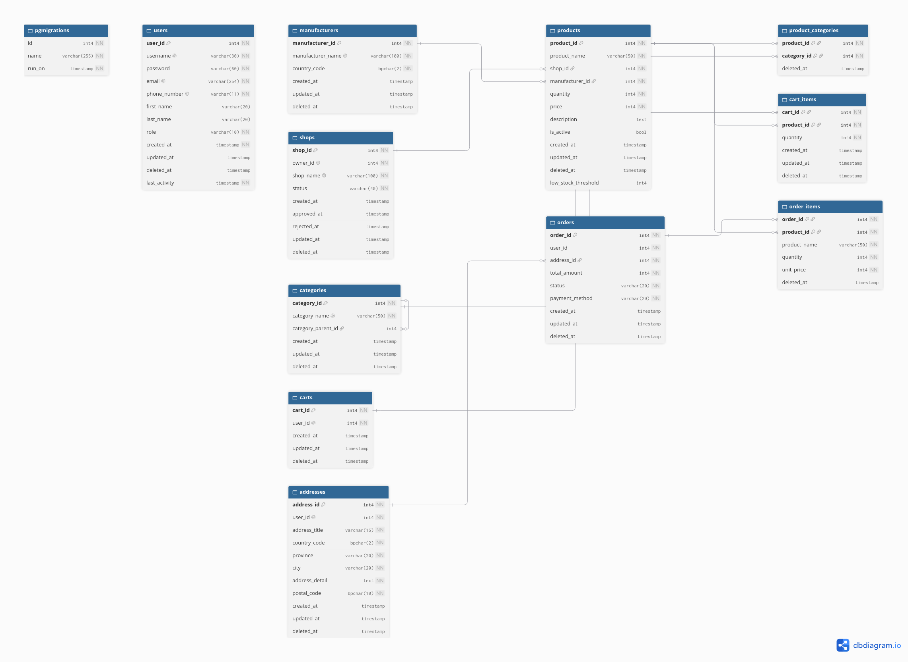

# Shopora

[🇬🇧 English](README.en.md) | [🇮🇷 فارسی](README.md)
یک بک‌اند فروشگاهی با الهام از معماری پروژه‌های واقعی، ساخته‌شده با Node.js، Express و TypeScript.

## معرفی پروژه

Shopora یک پلتفرم تجارت الکترونیک است که از بازارگاه‌های آنلاین شناخته‌شده‌ای مانند دیجی‌کالا الهام گرفته است.

تمرکز این پروژه بر معماری بک‌اند، اصول کدنویسی تمیز (Clean Code)، مقیاس‌پذیری و مفاهیم مهندسی نرم‌افزار در دنیای واقعی است، نه توسعه فرانت‌اند.

## اهداف پروژه

اهداف اصلی این پروژه عبارت‌اند از:

- یادگیری معماری بک‌اند در سطح سازمانی (Enterprise)
- ساخت یک REST API مقیاس‌پذیر
- تمرین احراز هویت و مجوزدهی
- پیاده‌سازی کنترل دسترسی مبتنی بر نقش (RBAC)
- استفاده از Redis برای کش‌کردن داده‌ها و بهینه‌سازی عملکرد
- پیاده‌سازی آپلود فایل با استفاده از فضای ذخیره‌سازی اشیا (به‌زودی)
- کار با وظایف پس‌زمینه (Cron Jobs) (به‌زودی)
- مستندسازی APIها با Swagger
- کانتینرسازی برنامه با Docker (به‌زودی)
- استقرار یک بک‌اند آماده برای محیط عملیاتی (Production)

## فناوری‌های مورد استفاده (Tech Stack)

- Node.js
- Express.js
- TypeScript
- PostgreSQL
- TypeORM
- Zod
- Redis
- JWT
- Swagger (OpenAPI)
- Docker
- Docker Compose
- MinIO (فضای ذخیره‌سازی اشیای سازگار با S3)

## ساختار پایگاه داده

پایگاه داده بر اساس ۱۱ جدول اصلی طراحی شده است. این جداول روابط یک‌به‌یک، یک‌به‌چند و چندبه‌چند (با استفاده از جداول واسط)، ساختار درختی دسته‌بندی‌های تو‌در‌تو با ارجاع به خود و همچنین ذخیره‌سازی snapshot قیمت و تعداد محصولات برای حفظ صحت تاریخچه سفارش‌ها را مدل‌سازی می‌کنند.

**فایل کامل ساختار SQL:** [`database/schema.sql`](database/schema.sql)

### جدول‌های پایگاه داده

| جدول               | کاربرد                                                             |
| ------------------ | ------------------------------------------------------------------ |
| `users`            | حساب‌های کاربری، اطلاعات احراز هویت و نقش‌ها                       |
| `products`         | کاتالوگ محصولات                                                    |
| `manufacturers`    | برندها و تولیدکنندگان؛ رابطه یک‌به‌چند با محصولات                  |
| `categories`       | دسته‌بندی‌های تو‌در‌تو با ساختار درختی                             |
| `product_category` | جدول واسط برای ایجاد رابطه چندبه‌چند میان محصولات و دسته‌بندی‌ها   |
| `carts`            | سبد خرید هر کاربر                                                  |
| `cart_items`       | محصولات موجود در سبد خرید                                          |
| `addresses`        | آدرس‌های ارسال هر کاربر؛ رابطه یک‌به‌چند                           |
| `orders`           | سفارش‌های ثبت‌شده                                                  |
| `order_items`      | snapshot اطلاعات محصولات خریداری‌شده، شامل قیمت ثبت‌شده هنگام خرید |
| `shops`            | فروشگاه‌های متعلق به کاربران                                       |

## قابلیت‌های اصلی

### احراز هویت (Authentication)

- ثبت‌نام کاربران
- ورود کاربران
- احراز هویت با JWT
- خروج از حساب کاربری
- هش‌کردن رمزهای عبور

### مجوزدهی (Authorization)

- کنترل دسترسی مبتنی بر نقش (RBAC)
- نقش‌های کاربری:
  - `User`: کاربر عادی
  - `Admin`: مدیر سیستم
  - `Owner`: صاحب فروشگاه

### محصولات (Products)

- مشاهده محصولات
- جست‌وجوی محصولات
- ویرایش محصولات
- فیلترکردن محصولات
- مرتب‌سازی محصولات
- صفحه‌بندی نتایج (Pagination)
- دسته‌بندی محصولات

### سبد خرید (Shopping Cart)

- دریافت اقلام سبد خرید
- افزودن محصولات به سبد خرید
- حذف اقلام از سبد خرید
- تغییر تعداد محصولات

### سفارش‌ها (Orders)

- ثبت سفارش
- مشاهده تاریخچه سفارش‌ها
- مدیریت وضعیت سفارش
- پیگیری سفارش

### تصاویر محصولات (به‌زودی)

- آپلود تصاویر محصولات
- ذخیره تصاویر در فضای ذخیره‌سازی سازگار با S3
- تولید URL عمومی برای تصاویر

### پنل مدیریت (Admin Panel)

- داشبورد مدیریتی
- مدیریت محصولات
- مدیریت دسته‌بندی‌ها
- مدیریت سفارش‌ها
- مدیریت کاربران
- مدیریت فروشگاه‌ها
- مدیریت برندها و تولیدکنندگان

### Redis

- کش محصولات (به‌زودی)
- کش سبد خرید (به‌زودی)
- محدودسازی تعداد درخواست‌ها (Rate Limiting)

### وظایف پس‌زمینه (Cron Jobs) (به‌زودی)

- شناسایی محصولات با موجودی کم
- پاک‌سازی سبدهای خرید رهاشده
- حذف Refresh Tokenهای منقضی‌شده
- اجرای وظایف نگهداری روزانه

### آپلود فایل (به‌زودی)

- آپلود فایل‌ها
- ذخیره فایل‌ها با استفاده از فضای ذخیره‌سازی سازگار با S3
- استفاده از MinIO برای محیط توسعه محلی
- تولید URLهای عمومی برای فایل‌های آپلودشده

### مستندسازی API

- مستندسازی APIها با Swagger (OpenAPI)

## استقرار (Deployment)

سرویس‌های در نظر گرفته‌شده برای Docker Compose:

- API
- PostgreSQL
- Redis
- MinIO (فضای ذخیره‌سازی اشیا) (به‌زودی)

## فضای ذخیره‌سازی اشیا (Object Storage) (به‌زودی)

این پروژه از MinIO، یک سرویس ذخیره‌سازی اشیای سازگار با S3، برای محیط توسعه محلی و اجرا در Docker استفاده می‌کند.

این بخش مفاهیم زیر را پوشش می‌دهد:

- ایجاد Bucket
- آپلود فایل‌ها
- دانلود فایل‌ها
- حذف فایل‌ها
- تولید URLهای عمومی
- یکپارچه‌سازی با AWS S3 SDK

## نقشه راه (Roadmap)

- [ ] طراحی پایگاه داده
- [ ] پیاده‌سازی احراز هویت
- [ ] پیاده‌سازی مجوزدهی (RBAC)
- [ ] پیاده‌سازی محصولات
- [ ] پیاده‌سازی دسته‌بندی‌ها
- [ ] پیاده‌سازی سبد خرید
- [ ] پیاده‌سازی سفارش‌ها
- [ ] پیاده‌سازی APIهای پنل مدیریت
- [ ] یکپارچه‌سازی Redis
- [ ] پیاده‌سازی فضای ذخیره‌سازی اشیا (S3 / MinIO)
- [ ] پیاده‌سازی آپلود فایل
- [ ] پیاده‌سازی وظایف پس‌زمینه (Cron Jobs)
- [ ] مستندسازی APIها با Swagger
- [ ] کانتینرسازی با Docker
- [ ] استقرار در محیط عملیاتی (Production)

## بهبودهای آینده (Future Improvements)

- یکپارچه‌سازی درگاه پرداخت
- فهرست علاقه‌مندی‌ها (Wishlist)
- ثبت نظرات و امتیازدهی به محصولات
- ارسال اعلان از طریق ایمیل
- تأیید سفارش از طریق ایمیل
- سیستم پیشنهاد محصول
- جست‌وجوی محصولات با Elasticsearch
- ارسال اعلان با WebSocket
- خط یکپارچه‌سازی و استقرار مداوم (CI/CD)
- تست‌های خودکار با Jest
- پایش و ثبت رویدادها (Monitoring & Logging)

---

هدف اصلی این پروژه، شبیه‌سازی معماری و گردش کار یک بک‌اند تجارت الکترونیک در سطح Production و به‌کارگیری بهترین شیوه‌های مدرن توسعه بک‌اند است.
